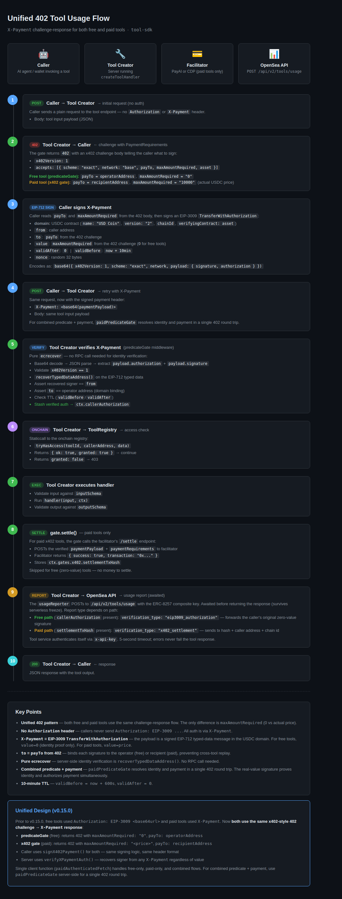

# Tool invocation flow

Free and paid tools share one 402 challenge-response flow.



## Sequence diagram

```
Caller                    Tool Server                 ToolRegistry (onchain)     Facilitator        OpenSea API
  │                            │                            │                       │                   │
  │  1. POST /tool (no auth)   │                            │                       │                   │
  │ ────────────────────────> │                            │                       │                   │
  │                            │                            │                       │                   │
  │  2. 402 PaymentRequirements│                            │                       │                   │
  │    maxAmountRequired: "0"  │  (free)                    │                       │                   │
  │    maxAmountRequired: amt  │  (paid)                    │                       │                   │
  │ <──────────────────────── │                            │                       │                   │
  │                            │                            │                       │                   │
  │  3. Sign X-Payment         │                            │                       │                   │
  │  (EIP-3009                 │                            │                       │                   │
  │   TransferWithAuthorization│                            │                       │                   │
  │   from: caller             │                            │                       │                   │
  │   to: payTo from 402       │                            │                       │                   │
  │   value: 0 or amount       │                            │                       │                   │
  │   nonce: random 32 bytes)  │                            │                       │                   │
  │                            │                            │                       │                   │
  │  4. POST /tool             │                            │                       │                   │
  │  X-Payment: base64(...)    │                            │                       │                   │
  │ ────────────────────────> │                            │                       │                   │
  │                            │                            │                       │                   │
  │                            │  5. ecrecover X-Payment    │                       │                   │
  │                            │     recover caller address │                       │                   │
  │                            │     verify to == operator  │                       │                   │
  │                            │     check TTL              │                       │                   │
  │                            │                            │                       │                   │
  │                            │  6. tryHasAccess(toolId,   │                       │                   │
  │                            │     callerAddr, data)      │                       │                   │
  │                            │ ────────────────────────> │                       │                   │
  │                            │   granted: true/false      │                       │                   │
  │                            │ <──────────────────────── │                       │                   │
  │                            │     false → 403            │                       │                   │
  │                            │                            │                       │                   │
  │                            │  7. handler(input, ctx)    │                       │                   │
  │                            │     validate input/output  │                       │                   │
  │                            │                            │                       │                   │
  │                            │  8. gate.settle() ─────────────────────────────> │                   │
  │                            │     (paid only: POST       │                       │                   │
  │                            │      /settle with payload) │  { tx: "0x..." }      │                   │
  │                            │ <───────────────────────────────────────────────── │                   │
  │                            │                            │                       │                   │
  │                            │  9. POST /api/v2/tools/usage ──────────────────────────────────────> │
  │                            │     (awaited before response)                      │                   │
  │                            │     free: eip3009_authorization (forward signature)│                   │
  │                            │     paid: x402_settlement (forward tx hash)        │                   │
  │                            │ <────────────────────────────────────────────────────────────────── │
  │                            │                            │                       │                   │
  │  10. 200 OK (tool output)  │                            │                       │                   │
  │ <──────────────────────── │                            │                       │                   │
```

### Details

- Free and paid tools use the same challenge-response. Only `maxAmountRequired` differs: `"0"` for free, the USDC price for paid.
- `X-Payment` carries an EIP-3009 `TransferWithAuthorization`, signed as EIP-712 typed data in the USDC domain. `value=0` proves identity only; `value=price` also pays.
- The server verifies identity with `recoverTypedDataAddress()` alone, without an RPC call. For `predicateGate`, the signed `to` must equal the recipient derived from the endpoint URL, tool ID, and operator. For `paidPredicateGate`, it must equal the operator address.
- `paidPredicateGate` resolves identity and payment in one 402 round trip: the real-value signature proves who the caller is (`from`) and authorizes the payment. The predicate is checked before settlement, so a denied caller gets a 403 and no funds move.
- Without a platform `waitUntil`, usage reporting is awaited, so the report finishes before the 200 goes out and survives a serverless freeze. With `waitUntil` (detected on Vercel, wired by `toCloudflareHandler`), it runs after the response. It has a 5-second timeout, and its errors never fail the tool response.
- SDK clients sign with a 10-minute TTL: `validBefore = now + 600s`, `validAfter = 0`.
- The tool server forwards the caller's original EIP-3009 authorization to the usage API unchanged. It never re-signs.
